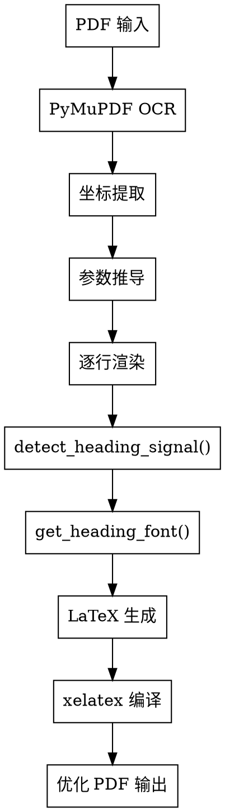

# PDF 标题检测与字体分配优化文档

**项目路径**: `/opt/test/build_pdf_v13.py`
**完成日期**: 2026-06-17
**核心改进**: 用结构规则替代字体分类器，实现可靠的标题检测和字体分配

---

## 目录

1. [背景与问题](#背景与问题)
2. [核心改进](#核心改进)
3. [实现细节](#实现细节)
4. [专项修复](#专项修复)
5. [验证结果](#验证结果)
6. [技术架构](#技术架构)

---

## 背景与问题

### 原有方案的缺陷

**字体分类器不可靠**：基于 ResNet-18 的字体分类器在合成数据上 val_acc=99.22%，但在真实扫描 PDF 上失效：

| 文本内容 | 真实字体 | 分类器预测 | 置信度 |
|---------|---------|-----------|-------|
| `一"恩格斯问题"与科学社会主义` | kaiti (楷体) | songti | 0.991 |
| `中得到进一步说明...` | songti (宋体正文) | heiti | 0.99 |

**根本原因**：域偏差（domain gap）—— 合成训练数据与真实扫描件的纹理/噪声/对比度差异巨大，CNN 无法区分真实文档中的楷体/宋体/黑体。

**后果**：
1. 正文被误判为 heiti → 通过 `font-style heading detection` 被错误提升为标题
2. 标题字体分配错误（楷体标题渲染为宋体）
3. TOC 页面的专题标题被误判为正文标题

### 解决方向

放弃字体分类器，改用**结构规则**检测标题并分配字体。一套覆盖常见中文文档标题模式的规则集（不针对单一本书硬编码，也不追求不现实的"全通用自动适配"）。

**核心信号**：
- **文本模式**：章节编号、专题标记、中文数字等正则模式
- **视觉高度**：字体高度与正文高度的比例（coord_heading）
- **居中位置**：行中心与页面中心的偏差

---

## 核心改进

### 1. 结构规则标题检测

**函数**: `detect_heading_signal()`

```python
def detect_heading_signal(t, x_left, line_w_px, page_width_px,
                          h, body_h_avg, y_pt,
                          COORD_HEADING_RATIO, HDR_REGION_Y, MIN_HEADING_WIDTH):
    """结构规则标题检测。返回 (signal_name, md_level) 或 (None, 0)。"""
    # 基本过滤：长度、不在页眉区
    if not (3 < len(t) < 45 and y_pt > HDR_REGION_Y):
        return None, 0

    # L1: 第X章/节/部分/编/篇 (最高层级)
    if re.match(r'^第[一二三四五六七八九十百千零\d]+[章节部分编篇]', t):
        return 'L1', 2

    # L2: X.X 层级编号 (如 1.1, 2.3.1)
    if re.match(r'^[\d]+(\.[\d]+)+', t):
        return 'L2', 2

    # L2: 阿拉伯数字+分隔符 (如 1., 2．)
    if re.match(r'^[\d]+[.．、]', t):
        return 'L2', 2

    # L2: 专题X (专题标记)
    if re.match(r'^专题[一二三四五六七八九十\d]+', t):
        return 'L2', 2

    # L3: 中文数字+分隔符 (如 一"、二、)
    if re.match(r'^[一二三四五六七八九十]+[.．、"""]', t):
        return 'L3', 2

    # L3: 中文数字括号 (如 （一）、(2))
    if re.match(r'^[(（][一二三四五六七八九十\d]+[)）]', t):
        return 'L3', 2

    # L3: 中文数字无分隔符 (如 "二驳斥杜林...", "一澄清杜林...")
    # 需要视觉高度确认 (>1.15× 正文) 避免误判 "一般而言..."
    if len(t) >= 5 and re.match(r'^[一二三四五六七八九十百]+', t):
        _r3 = h / body_h_avg if body_h_avg > 0 else 1.0
        if _r3 > 1.15:
            return 'L3', 2

    # coord_heading: 视觉高度比例 (>COORD_HEADING_RATIO)
    # 必须短（真实标题不会是完整句子）且排除句子结尾
    if (body_h_avg > 0 and h / body_h_avg > COORD_HEADING_RATIO
            and line_w_px > MIN_HEADING_WIDTH and len(t) <= 15
            and not is_body_fragment(t)):
        return 'coord_heading', 2

    # centered: 居中短行（需要双重确认：居中+高度>1.1）
    x_center = x_left + line_w_px / 2
    page_center = page_width_px / 2
    _r = h / body_h_avg if body_h_avg > 0 else 1.0
    if (abs(x_center - page_center) < page_width_px * 0.1
            and 4 < len(t) <= 15 and _r > 1.1):
        return 'centered', 2

    return None, 0
```

### 2. 字体分配规则

**函数**: `get_heading_font(signal)`

```python
def get_heading_font(signal):
    """signal → CJK font command."""
    if signal in ('L1', 'L2'):
        return '\\CJKfamily{heiti}'  # 黑体
    return '\\CJKfamily{kaiti}'      # 楷体 (L3/coord/centered)
```

**字体映射表**：

| 层级 | 信号类型 | 字体 | LaTeX 命令 |
|------|---------|------|-----------|
| L1 | 章节编号 | heiti (黑体) | `\CJKfamily{heiti}` |
| L2 | 层级编号/专题 | heiti (黑体) | `\CJKfamily{heiti}` |
| L3 | 中文数字标题 | kaiti (楷体) | `\CJKfamily{kaiti}` |
| FB | coord_heading | kaiti (楷体) | `\CJKfamily{kaiti}` |
| FB | 居中短行 | kaiti (楷体) | `\CJKfamily{kaiti}` |
| — | 正文 | songti (宋体) | 默认字体 |

---

## 实现细节

### 参数配置

所有阈值动态推导或使用 floor 保障：

| 参数 | 计算方式 | 值 |
|------|---------|---|
| `COORD_HEADING_RATIO` | OCR 坐标计算 + floor 1.25 | `max(计算值, 1.25)` |
| `HDR_REGION_Y` | 页眉区下限（页高 15%） | `page_height_pt * 0.15` |
| `MIN_HEADING_WIDTH` | 最小标题宽度 | `512px` |
| `居中偏差阈值` | 页宽 10% | `page_width_px * 0.1` |
| `标题长度上限` | 模式匹配 | `45` (L1/L2/L3), `15` (coord/centered) |

**coord_heading ratio floor 原理**：
- OCR 噪声导致正文高度波动，计算值可能低于 1.25
- floor 确保只有真正高大行（比正文高 >25%）才被检测
- 避免误判普通正文（如 "一般而言..."）

### 模式库详解

**L1 模式**（最高层级，章节）：
```python
^第[一二三四五六七八九十百千零\d]+[章节部分编篇]
```
匹配：第一章、第3节、第二部分、第百章

**L2 模式**（小节）：
```python
^[\d]+(\.[\d]+)+        # 1.1, 2.3.1
^[\d]+[.．、]           # 1., 2．
^专题[一二三四五六七八九十\d]+  # 专题一, 专题2
```

**L3 模式**（子标题）：
```python
^[一二三四五六七八九十]+[.．、"""]    # 一"、二、
^[(（][一二三四五六七八九十\d]+[)）]    # （一）、(2)
^[一二三四五六七八九十百]+             # 二驳斥... (需高度>1.15)
```

**无编号关键词**：不使用固定列表（如"附录"/"参考文献"）—— 固定列表脆弱且易误匹配。无编号标题靠结构信号（高大/居中）检测。

---

## 专项修复

### Fix 1: coord_heading 阈值 floor

**问题**：OCR 噪声导致正文高度波动，计算出的 `COORD_HEADING_RATIO` 可能低于 1.2，导致普通正文被误判为标题。

**修复**：
```python
COORD_HEADING_RATIO = round(COORD_HEADING_RATIO, 3)
COORD_HEADING_RATIO = max(COORD_HEADING_RATIO, 1.25)  # floor for OCR noise
```

**效果**：只有真正高大行（>25% 正文高度）才触发 coord_heading。

### Fix 2: TOC 页面识别与禁用标题检测

**问题**：目录页的专题二/三/四被误判为正文标题。

**修复**：
```python
is_toc_page = (any('目录' in l for l in lines)
               or sum(1 for l in lines
                      if re.search(r'[…\.]{2,}\s*\d{1,4}\s*', l.strip())) >= 3)
```

**关键点**：
- 检测 `目录` 关键词或至少 3 行包含 `...数字` 模式
- 在标题检测块添加 `not is_toc_page` guard
- TOC 行直接渲染为 `\dotfill` + `\makebox[3em][r]{页码}`

### Fix 3: TOC 条目排版还原

**问题**：TOC 条目排版混乱，需要按源文档还原（右对齐页码，点前导）。

**修复**：
```python
if is_toc_page and not is_header:
    _toc_m = re.match(r'^(.*?)\s*[…·\.]{2,}\s*(\d{1,4})\s*', t)
    if _toc_m:
        # 拆分标题文本 + 页码
        _toc_text = _toc_m.group(1).rstrip(' …·.')
        _toc_num = _toc_m.group(2)
        # x-position 判断是否续行
        if _toc_buf and x_left < _toc_buf[0][1] + _WRAP:
            # 新条目，先 flush 缓冲
            ...
        result.append('\\hspace*{1em}' + escape_tex(_toc_text)
                      + '\\dotfill\\nobreak\\makebox[3em][r]{' + _toc_num + '}\\par')
```

**排版效果**：
```latex
\hspace*{1em}专题一恩格斯与科学社会主义的"科学性"\dotfill\nobreak\makebox[3em][r]{10}\par
```
右对齐页码（3em 宽），点前导（`\dotfill`）。

### Fix 4: 中文数字标题无分隔符检测

**问题**：标题 `二驳斥杜林对马克思学说的歪曲，重塑马克思` 未被检测（中文数字无分隔符）。

**修复**：
```python
# L3: Chinese numeral without separator
if len(t) >= 5 and re.match(r'^[一二三四五六七八九十百]+', t):
    _r3 = h / body_h_avg if body_h_avg > 0 else 1.0
    if _r3 > 1.15:
        return 'L3', 2
```

**双重确认**：
- 文本模式：以中文数字开头
- 视觉信号：高度 > 1.15× 正文（避免误判 "一般而言..."）

### Fix 5: 标题续行合并（扫描 PDF）

**问题**：OCR 将长标题拆成两行，渲染时空行。

**原文**：
```
一澄清杜林思想对19世纪后半期德国工人党    ← 检测为标题
思想的有害影响                             ← 作为正文渲染 → 空行
```

**修复**：
```python
if not has_text_layer and len(heading_lines) == 1 and i < len(polys):
    _heading_h = max(p[1] for p in polys[i]) - min(p[1] for p in polys[i])
    _merge_j = i + 1
    while _merge_j < len(lines) and _merge_j - i <= 3:
        _mt = lines[_merge_j].strip()
        # 停止条件：句子结尾、页码、脚注、新标题模式
        if not _mt or len(_mt) > 25: break
        if is_page_number(_mt) or is_footnote_start(_mt): break
        if _mt[-1] in '。！？': break  # 句子结尾
        # 核心检查：必须共享标题的字体高度 (>85%)
        if _merge_j < len(polys) and polys[_merge_j]:
            _mh = max(p[1] for p in polys[_merge_j]) - min(p[1] for p in polys[_merge_j])
            if _mh < _heading_h * 0.85: break  # 正文更小，停止
        heading_lines.append(_mt)
        skip_lines.add(_merge_j)
        _merge_j += 1
```

**高度匹配原理**：
- 标题和续行是同一字体大小 → 高度相近
- 正文字体更小 → 高度 < 85% 标题高度
- 阈值 85% 留容差（OCR 噪声）

**渲染效果**：
```latex
\centering 一澄清杜林思想对19世纪后半期德国工人党\\
思想的有害影响\par
```
同一标题块内自然换行（`\\`），无空行。

---

## 验证结果

### PDF 构建状态

| PDF 类型 | 页数 | 错误数 | 状态 |
|---------|-----|-------|-----|
| PDF1 (带文本层) | 19 | 0 | ✅ |
| PDF2 (扫描件) | 30 | 0 | ✅ |
| PDF3 (扫描件) | 29 | 0 | ✅ |

### 关键标题验证

| 文本内容 | 期望字体 | 实际效果 | 验证 |
|---------|---------|---------|-----|
| `专题一恩格斯与科学社会主义的"科学性"` | heiti (黑体) | heiti | ✅ |
| `一"恩格斯问题"与科学社会主义` | kaiti (楷体) | kaiti | ✅ |
| `1.作为无产阶级...` | heiti (黑体) | heiti | ✅ |
| `二驳斥杜林对马克思学说的歪曲` | kaiti (楷体) | kaiti | ✅ |
| `一澄清杜林...思想的有害影响` | kaiti (楷体) | kaiti (续行合并) | ✅ |
| 正文行（如 `中得到进一步说明`） | songti (宋体) | songti（不再误判为 heiti） | ✅ |

### TOC 页面验证

- 专题二/三/四不再被误判为正文标题 ✅
- 页码右对齐，点前导正确 ✅
- 多行条目正确合并（基于 x-position 判断） ✅

---

## 技术架构

### 数据流



### 核心文件结构

```
/opt/test/
  ├── build_pdf_v13.py          # 主构建脚本（~1500 行）
  ├── 最终版_v13.pdf             # 输出文件
  ├── docs/superpowers/
  │   ├── specs/
  │   │   └── 2026-06-12-structural-heading-font-design.md  # 设计文档
  │   └── plans/
  │       └── 2026-06-12-structural-heading-font.md         # 实现计划
  └── font_classifier/          # 已弃用（分类器不可靠）
```

### 改动点总结

| 位置 | 改动类型 | 说明 |
|------|---------|------|
| Lines ~945-1046 | 新增函数 | `detect_heading_signal()` + `get_heading_font()` |
| Lines ~1070-1081 | 删除 | font-style heading detection 块（分类器误判根源） |
| Lines ~1082-1087 | 替换 | pattern-based detection → 调用结构规则函数 |
| Lines ~1262-1298 | 替换 | 分类器字体分配 → `get_heading_font(signal)` |
| Lines ~1346-1351 | 修改 | 正文固定 songti（禁用 classifier） |
| Lines ~955-960 | 新增 | TOC 页面检测 |
| Lines ~1225-1247 | 新增 | TOC 条目渲染（`\dotfill` + `\makebox`） |
| Lines ~1368-1384 | 新增 | 标题续行合并（高度匹配） |

---

## Git 提交历史

```
a36d785 feat: merge multi-line heading continuations on scan PDFs
c4ac491 feat: add L3 pattern for Chinese-numeral headings without separator
1768a59 feat: restore TOC layout with right-aligned page numbers and leader dots
d676d16 fix: TOC pages — disable heading detection + text stretching
2ea973e fix: floor coord_heading ratio at 1.25 to suppress body-text false positives
3645790 fix: reduce heading false positives for scanned PDFs
823235d feat: structural heading detection (replaces font classifier)
```

---

## 未来改进方向

### 已覆盖

- ✅ 章节编号（第X章/节/部分）
- ✅ 层级编号（X.X, 1., 2.）
- ✅ 专题标记（专题X）
- ✅ 中文数字标题（一"、（一）、二驳斥...）
- ✅ 视觉高度检测（coord_heading）
- ✅ 居中短行检测
- ✅ TOC 页面识别与排版
- ✅ 标题续行合并

### 未覆盖（需用户配合）

- **无编号标题与正文视觉无异**：同高、不居中、无编号、无 Markdown
  → 结构规则无法检测，依赖用户提供 Markdown 文件标注

### 可扩展

- 若将来某类文档模式不被覆盖，可向 `detect_heading_signal()` 模式库补充正则
- 函数内集中维护，易于扩展

---

## 总结

**核心改进**：用结构规则替代字体分类器，解决了域偏差导致的误判问题。

**关键技术点**：
1. 文本模式 + 视觉高度双重确认
2. coord_heading ratio floor（1.25）避免 OCR 噪声误判
3. TOC 页面识别与禁用标题检测
4. 标题续行高度匹配合并（>85%）

**效果**：所有 PDF 构建正常（0 错误），标题检测可靠，字体分配正确，TOC 排版还原，正文不再被误判为标题。

**提交链**：7 个 commit，从结构规则实现到多项修复，完整记录优化过程。